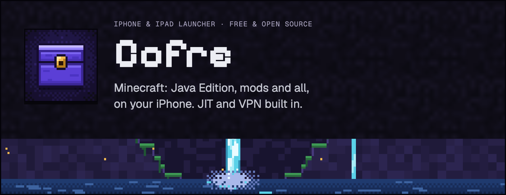
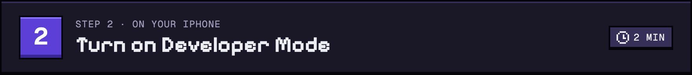
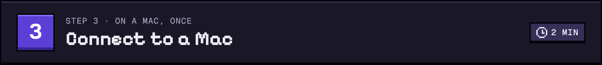
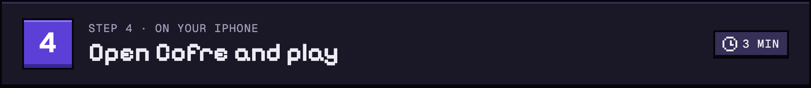
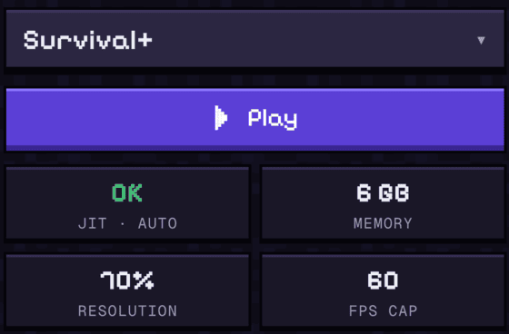

<p align="center">
  
</p>

<p align="center">
  <a href="https://github.com/ignaciojuarez/cofre/issues/new?template=invite.yml"></a>
</p>

<p align="center"><b>4 steps · about 10 minutes · one Mac visit</b></p>

**Cofre** is a free, open-source Minecraft: Java Edition launcher for iPhone and iPad, with JIT (what makes Java fast on iPhone) and a local VPN built in. Setup takes one Terminal command on a Mac, once. The same steps are at [ignaciojuarez.github.io/cofre](https://ignaciojuarez.github.io/cofre/).

---


1. Tap **Request an invite** and tell us who you are.
2. We send you a link. Open it on your iPhone so we can add it to Cofre.
3. When your install link arrives, open it on your iPhone and tap **Install**.

<a href="https://github.com/ignaciojuarez/cofre/issues/new?template=invite.yml"></a>

<details>
<summary><b>Advanced: sideload the IPA</b></summary>

Not on the invite list, or have your own developer account? Install the IPA with your own Apple ID (for example AltStore or SideStore).

| | Free Apple ID | Paid account ($99/year) |
|---|---|---|
| App lasts | 7 days | 1 year |
| Apps at once | 3 | No limit |
| Built-in VPN | No (use a separate VPN app) | Yes |
| JIT | Yes | Yes |

Limits are Apple's: [free vs paid accounts](https://developer.apple.com/support/compare-memberships/) · [VPN needs a paid account](https://developer.apple.com/help/account/reference/supported-capabilities-ios).

<a href="https://github.com/ignaciojuarez/cofre/releases/latest/download/Cofre.ipa"></a>
</details>



1. Open **Settings → Privacy & Security**.
2. Scroll to **Security**, tap **Developer Mode**, turn it on.
3. Tap **Restart**. After it restarts, unlock, tap **Turn On** (or **Enable**) and enter your passcode.

> **Don't see it?** Tap the Cofre icon once. iOS says "Developer Mode Required"; then look in Privacy & Security again. Still not there? Do Step 3 first: connecting to a Mac makes the switch appear. Then come back.



1. Have Cofre installed on your iPhone (Step 1).
2. Plug your iPhone into the Mac with a cable.
3. Open **Terminal** (<kbd>⌘</kbd> <kbd>Space</kbd>, type `Terminal`, <kbd>Return</kbd>). Paste this and press <kbd>Return</kbd>:

   ```sh
   curl -fsSL https://github.com/ignaciojuarez/cofre/releases/latest/download/pair.sh | sh
   ```

4. A Cofre window opens and guides you: unlock your iPhone, tap **Trust**, enter your passcode, then wait for **Done**.
5. Open Cofre on your iPhone. It's ready.

> [!CAUTION]
> **Never share this file. It's a key to your iPhone.** Don't paste or upload your pairing file to any chat, website or person, not even ChatGPT or Claude.

<details>
<summary><b>If the window shows "Send with AirDrop"</b></summary>

1. Click **Send with AirDrop** and pick your iPhone. Not listed? On the iPhone, open Control Center, touch and hold the top-left group, tap **AirDrop → Everyone for 10 Minutes**.
2. On the iPhone, tap **Accept**. On iOS 26.2 or later it may ask for an **AirDrop code**: tap **Get AirDrop Code** and type the code on the Mac. (Same Apple Account on both? It's accepted by itself.)
3. On the iPhone, open **Files → Downloads**, tap the file named after your iPhone, then **Share → Cofre**.
4. When Cofre says **Key found**, delete the file from Downloads.

The window also has **Save a copy**, as a last resort. If you use it, AirDrop the copy, then move it to the Trash.
</details>

<a href="PAIRING.md"></a>

Stuck? [PAIRING.md](PAIRING.md#ask-chatgpt-or-claude) has troubleshooting and a ready-made prompt for ChatGPT or Claude. They can only explain; the command does the work.




1. Open Cofre and tap **Set up**. Your key is already inside, so it skips ahead to the VPN.
2. Tap **Allow VPN**. When iOS asks, tap **Allow** and enter your passcode. Cofre tests JIT by itself and moves on.
3. Tap **Sign in with Microsoft**, then **Play**.

From then on, just tap Play. JIT and the VPN turn on by themselves.



---

## What you need

| | |
|---|---|
| 📱 **iPhone or iPad, iOS 26** | Tested on iPhone 17 Pro with iOS 26. Other iPhones and iPads on iOS 26 should work but aren't tested yet. Wait for our OK before big iOS updates. |
| 🔑 **Minecraft: Java Edition** | A Microsoft account that owns Java Edition. Minecraft bought on a phone or console doesn't include it. |
| 💻 **A Mac, just once** | For Step 3: about 2 minutes, plus a cable for your iPhone. A friend's Mac works too. **Windows & Linux: coming soon.** |
| 💾 **Free space and Wi-Fi** | Keep about 8 GB free. Cofre is about 760 MB; each modpack takes 1–6 GB. Turning on JIT needs Wi-Fi, or Airplane Mode for a moment. |

## What works, and the limits

| ✅ Works | ⚠️ Limits |
|---|---|
| **Play with PC friends.** It's real Java Edition, so you join the same servers as PC players. Bedrock players (consoles, phones) can join only if the server runs Geyser. | **Memory.** Phones have less RAM than PCs. Cofre picks a safe amount automatically. If a pack closes while loading, lower Memory or Resolution in **Settings → Game**. |
| **Modded servers.** Fabric, Quilt, Forge and NeoForge. Install the server's modpack or the same mods from Modrinth or CurseForge. | **PC-only mods.** Mods with desktop native code don't work, such as Simple Voice Chat, Plasmo Voice and Sound Physics Remastered. |
| **Coming: one-tap Join.** Servers will be able to publish a card so Cofre installs the right mods and joins for you. | **iOS updates** can break JIT. Turn off automatic updates and wait for our OK. |

## Help

<details><summary><b>JIT won't turn on</b></summary>

1. Check **Developer Mode** is on (Step 2).
2. Use Wi-Fi, or turn on Airplane Mode for a moment. Turn off any other VPN (work, ad blocker): iOS runs one VPN at a time.
3. Right after a restart, JIT needs internet once to set up.
4. Close Cofre fully and open it again. Then try **Settings → JIT & Java → Test JIT**.
5. Still failing? Your pairing key may be stale. See the next answer.
</details>

<details><summary><b>It stopped working after an iOS update or a reset</b></summary>

An iOS update, erasing the iPhone, or **Reset Location & Privacy** can make your pairing key stop working. Redo Step 3: plug in and run the command again (2 minutes).

To avoid it: **Settings → General → Software Update → Automatic Updates**, turn them off.
</details>

<details><summary><b>Why does Cofre ask to add a VPN?</b></summary>

JIT needs Cofre to talk to your own iPhone. The VPN is local: it only carries that one connection inside the phone. Your browsing doesn't go through it. Tap **Allow** and enter your passcode.
</details>

<details><summary><b>"Not enough storage"</b></summary>

Keep about 8 GB free. Delete instances you don't play in **Instances**, and check **Settings → General → iPhone Storage**.
</details>

<details><summary><b>Can I share my pairing file?</b></summary>

**No. Never paste or upload it to any chat, website or person, not even ChatGPT or Claude.** It's a key to your iPhone: anyone who has it can control your phone like a trusted computer. It also only works for the iPhone it was made for. Everyone runs Step 3 for their own phone.

Used AirDrop? Delete the file from **Files → Downloads** once Cofre says Key found, and any copy you saved on a Mac.
</details>

<details><summary><b>Is the Terminal command safe?</b></summary>

It downloads a small helper signed by us into a temporary folder, opens it, puts the key inside Cofre over the cable, and deletes itself. Nothing is installed or uploaded, and it never asks for a password. [Read exactly what it does](PAIRING.md).
</details>

<details><summary><b>Does it work on cellular data?</b></summary>

Turning on JIT needs Wi-Fi or Airplane Mode. No Wi-Fi? Open Cofre, turn on Airplane Mode, tap **Play**, then turn Airplane Mode off once the game is loading.
</details>

<details><summary><b>How long does Cofre last?</b></summary>

Invite installs last 1 year. Cofre warns you 30 days before. Installing the new link keeps your worlds. Sideloaded with a free Apple ID: 7 days, then refresh.
</details>

## Privacy & safety

- 🔑 **Your pairing key is never uploaded.** It goes from the Mac straight into Cofre over the cable. Cofre keeps it on the phone and never logs it. Nothing stays on the Mac unless you save a copy.
- 🛡️ **The helper deletes itself.** It runs from a temporary folder and is gone when it says Done. Nothing installed, no password, no account.
- 📶 **Local VPN, Microsoft sign-in.** The VPN never leaves your phone. You sign in on Microsoft's own page.
- 📖 **Open source.** Cofre is GPL-3.0. Read every line, or build it yourself.

<a href="https://github.com/ignaciojuarez/cofre"></a>

---

**Not an official Minecraft product. Not approved by or associated with Mojang or Microsoft.** Minecraft is a trademark of Mojang AB.

Cofre is **GPL-3.0**, a fork of [Air](https://github.com/herbrine8403/Amethyst-iOS-MyRemastered) and [Amethyst](https://github.com/AngelAuraMC/Amethyst-iOS) (GPL-3.0). JIT by [StikJIT](https://github.com/StikDebug/StikJIT) (MPL-2.0). Device pairing by [idevice](https://github.com/jkcoxson/idevice) (MIT). Fonts: Pixelify Sans, Geist and Geist Mono ([SIL OFL 1.1](docs/fonts/OFL.txt)). Pixel art is original.

---

## For maintainers

**The site** is `docs/`: plain HTML, CSS and a few lines of JS. No build step. It's served by GitHub Pages at **https://ignaciojuarez.github.io/cofre/** (*Settings → Pages → Deploy from branch → `main` / `/docs`*). It makes no requests to other sites (enforced by a Content-Security-Policy). There's no custom domain: an unregistered one could be taken by anyone, and people paste what the site shows into Terminal.

**Links.** Every site URL lives in one object, `LINKS`, at the top of [`docs/app.js`](docs/app.js). The README and `PAIRING.md` can't run JS, so they repeat them. The app's copy is `CofreLinks` (`app/UI/Sources/CofreUI/CofreUI.swift`, with a host allowlist test) and Llave's is `getCofre` (`ContentView.swift`).

| Key | URL | Used for |
|---|---|---|
| `site` | `https://ignaciojuarez.github.io/cofre/` | The setup site; Llave's "How to get Cofre" opens `#step-1` |
| `pair` | `https://ignaciojuarez.github.io/cofre/pair/` | The short link the app shows; [`docs/pair/`](docs/pair/index.html) sends it to Step 3 |
| `invite` | `https://github.com/ignaciojuarez/cofre/issues/new?template=invite.yml` | Request an invite (Step 1) |
| `ipa` | `https://github.com/ignaciojuarez/cofre/releases/latest/download/Cofre.ipa` | Advanced: sideload the IPA |
| `pairScript` | `https://github.com/ignaciojuarez/cofre/releases/latest/download/pair.sh` | The Step 3 command: `curl -fsSL <pairScript> \| sh` |
| `pairingGuide` | `https://github.com/ignaciojuarez/cofre/blob/main/PAIRING.md` | "What the command does" and the ChatGPT/Claude prompt |
| `source` | `https://github.com/ignaciojuarez/cofre` | Source links |

To publish: make sure the release assets are named `Cofre.ipa` and `pair.sh`, and that `.github/ISSUE_TEMPLATE/invite.yml` exists (the invite link opens it).

**README images** (`docs/assets/readme/*.png`) are rendered from [`site/tools/readme-art.html`](site/tools/readme-art.html) with the site's own CSS:

```sh
npm i --no-save playwright-core
CHROME=/path/to/chrome-headless-shell node site/tools/render-readme-images.cjs
```

**Facts on the site** were checked on 2026-10-28 and 2026-10-29. See [`site/FACTS.md`](site/FACTS.md) for sources.
